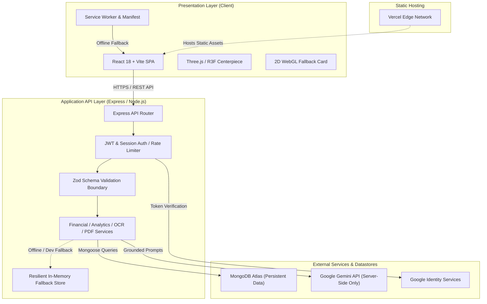
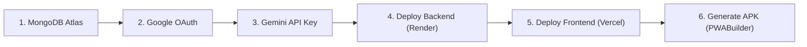
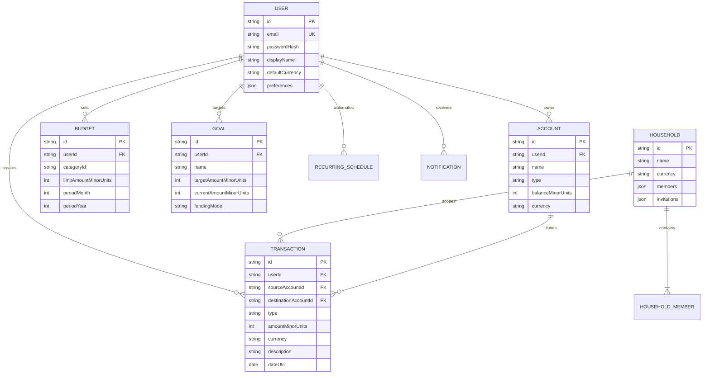

# 🌌 LumaSpend — Premium 3D Fintech Expense Tracker & Intelligence App

> **LumaSpend** (Smart Expense Tracker) is a production-oriented, full-stack personal finance and financial intelligence application. Built with a TypeScript MERN architecture, it pairs a cinematic 3D visual centerpiece with an agile integer-precision transaction ledger, Google Gemini-powered financial advisory, receipt OCR scanning, shared household budgets, PDF statement generation, and progressive web app (PWA) installation with Android APK generation support.

[](https://www.typescriptlang.org/)
[](https://react.dev/)
[](https://expressjs.com/)
[](https://www.mongodb.com/)
[](https://tailwindcss.com/)
[](https://threejs.org/)
[](https://vitest.dev/)
[](https://web.dev/progressive-web-apps/)

---

## 📑 Table of Contents
1. [Project Overview & Features](#-project-overview--features)
2. [System Architecture & Data Flow](#-system-architecture--data-flow)
3. [Technology Stack](#-technology-stack)
4. [Prerequisites & Local Installation](#-prerequisites--local-installation)
5. [Environment Variables Reference](#-environment-variables-reference)
6. [Step-by-Step Manual Operations Guide](#-step-by-step-manual-operations-guide)
   - [A. MongoDB Atlas Setup](#a-mongodb-atlas-database-setup)
   - [B. Google Cloud OAuth 2.0 Setup](#b-google-cloud-oauth-20-setup)
   - [C. Google AI Studio Gemini API Key](#c-google-ai-studio-gemini-api-key)
   - [D. Backend Deployment (Render / Railway)](#d-backend-deployment-render--railway)
   - [E. Frontend Deployment (Vercel)](#e-frontend-deployment-vercel)
   - [F. Android APK Generation (PWABuilder / Capacitor)](#f-android-apk-generation-guide)
7. [Database Domain Models](#-database-domain-models)
8. [REST API Documentation](#-rest-api-documentation)
9. [Automated Verification & Test Report](#-automated-verification--test-report)
10. [College / Viva Presentation Demonstration Script](#-college--viva-presentation-demonstration-script)
11. [Application Security & Hardening](#-application-security--hardening)
12. [Troubleshooting & Limitations](#-troubleshooting--limitations)

---

## 🚀 Project Overview & Features

### 1. Financial Ledger & Wallet Management
* **Strict Minor-Unit Precision:** All monetary calculations run strictly on integers (paise for INR, cents for USD) to eliminate IEEE 754 floating-point rounding errors.
* **Multi-Wallet Support:** Manage Cash, Checking, Savings, UPI, and Credit Card accounts with calculated balances and transfer tracing.
* **Transfers Isolation:** Internal account transfers adjust balances atomically without artificially inflating income or expense totals in financial reports.
* **Search, Filter & Sorting:** Date range bounds, account filtering, category filtering, and ReDoS-safe search.
* **CSV Bulk Import/Export:** Two-stage preview import with automatic error highlighting, duplicate detection, and streaming CSV export.

### 2. Financial Intelligence & Budgets
* **Category & Overall Monthly Budgets:** Set spending limits with progress indicators and configurable thresholds (75%, 90%, 100%).
* **Visual Analytics & Cash-Flow Trends:** Interactive Recharts charts for income vs. expense, daily/weekly/monthly trends, category distribution, and previous-period variance.
* **Savings Goals with Pace Calculation:** Track target amounts and deadlines with automatic daily and monthly pace requirements. Distinguishes between explicit contributions and linked-account balances to prevent double-counting.
* **Recurring Bills Engine:** Idempotent recurring transaction and reminder engine with leap-year and timezone handling.
* **Executive PDF Statements:** Server-streamed executive PDF statements with summary KPI cards, cash-flow tables, and category breakdowns via PDFKit.

### 3. AI Assistant & Computer Vision (OCR)
* **Google Gemini Integration:** Secure server-side AI financial advisor using `@google/genai` grounded in authenticated user summaries. Never leaks raw credentials or API keys.
* **Deterministic Fallback Engine:** Instant rule-based answers for standard questions if the Gemini API quota is offline or unconfigured.
* **Receipt OCR Scanning:** Built-in receipt scanning via Tesseract.js with binary magic-byte verification, merchant/amount candidate extraction, and an interactive confirmation modal before any transaction is logged.

### 4. Shared Households & Collaboration
* **Multi-User Spaces:** Create shared household spaces with strict role hierarchy:
  * `Owner`: Full administration, member management, and space deletion.
  * `Editor`: Can view and log shared transactions.
  * `Viewer`: Read-only access to household spending and budgets.
* **Single-Use Cryptographic Invitations:** Generates expiring invite tokens tied to invitee email addresses with copyable acceptance links.
* **Strict Privacy Partitioning:** Personal user transactions remain completely private and inaccessible to household members.

### 5. Mobile & Desktop Experience (PWA & APK)
* **Progressive Web App (PWA):** Web App Manifest, theme colors, dark fintech styling, and Service Worker.
* **Zero-Trust Cache Policy:** Service worker explicitly bypasses all authenticated `/api/*` financial routes and sensitive HTML to protect confidential data on shared devices.
* **Offline Fallback:** Renders a dedicated offline status card during network interruptions.
* **3D Visual Centerpiece:** Interactive Three.js/Fiber/Drei floating financial cards with an automatic 2D SVG/CSS fallback if WebGL is disabled or unsupported.
* **Compliance & Data Sovereignty:** Full GDPR JSON archive export and cascading account deletion requiring explicit confirmation (`"DELETE MY ACCOUNT"`).

---

## 🏛️ System Architecture & Data Flow



---

## 💻 Technology Stack

| Layer | Technology | Version | Purpose |
| :--- | :--- | :--- | :--- |
| **Frontend Framework** | React + Vite + TypeScript | React 18.3 / Vite 5.4 | High-performance single page application |
| **3D & Spatial Layer** | Three.js, React Three Fiber, Drei | Three 0.170 | Cinematic floating fintech cards with 2D fallback |
| **Styling & Design** | Tailwind CSS + Lucide Icons | Tailwind 3.4 | Controlled glassmorphism & dark fintech palette |
| **Data Visualization** | Recharts | 2.15 | Responsive financial charts (Area, Bar, Pie) |
| **Backend API** | Node.js + Express + TypeScript | Express 4.21 / Node 20+ | REST API, authentication, business logic |
| **Database** | MongoDB Atlas via Mongoose | Mongoose 8.9 | Multi-tenant schema storage with resilient memory mode |
| **Authentication** | Google Identity Services + JWT | jsonwebtoken 9.0 / bcryptjs 3.0 | HTTP-only cookie sessions + Google ID token verification |
| **Schema Validation** | Zod | 3.24 | Runtime type-safety at all network boundaries |
| **Artificial Intelligence**| Google Gen AI SDK | `@google/genai` 2.28 | Financial advisor and category intelligence |
| **Receipt OCR** | Tesseract.js | 7.0 | Binary-verified image text parsing |
| **PDF Reporting** | PDFKit | 0.20 | Server-streamed executive financial statements |
| **PWA & Offline** | Service Worker + Web Manifest | Manifest v3 compliant | Installable mobile experience & offline fallback |
| **Test Framework** | Vitest + React Testing Library + Supertest | Vitest 2.1 | 111 unit, integration, and security tests |

---

## 📦 Prerequisites & Local Installation

### Prerequisites
* **Node.js**: v18.0.0 or higher (v20+ or v22+ recommended)
* **npm**: v9.0.0 or higher
* **Git**: Installed on your system

### 1. Clone & Install
```bash
git clone https://github.com/sriteja2007/Smart-Expense-Tracker.git
cd Smart-Expense-Tracker

# Install dependencies across all workspaces (@lumaspend/shared, server, client)
npm install
```

### 2. Configure Local Environment
```bash
# Create server environment file
cp server/.env.example server/.env

# Create client environment file
cp client/.env.example client/.env
```

### 3. Build Shared Packages
```bash
npm run build:shared
```

### 4. Start Local Development
```bash
# Run both Backend API and Frontend Vite client concurrently:
npm run dev

# Or start services individually:
npm run dev:server   # Starts API on http://localhost:5000
npm run dev:client   # Starts Vite on http://localhost:5173
```

---

## 🔑 Environment Variables Reference

### Backend (`server/.env`)
| Variable | Required | Default / Example | Purpose |
| :--- | :---: | :--- | :--- |
| `PORT` | Optional | `5000` | Port for the Express HTTP server |
| `NODE_ENV` | Yes | `development` / `production` | Node execution environment |
| `CLIENT_URL` | Yes | `http://localhost:5173` | Allowed frontend origin for CORS (comma-separated for multiple) |
| `MONGODB_URI` | Yes | `mongodb+srv://<user>:<pwd>@cluster.mongodb.net/lumaspend` | MongoDB Atlas connection string |
| `JWT_SECRET` | Yes | `lumaspend_secret_min_32_characters_123456` | Secret for signing session JWT tokens |
| `GEMINI_API_KEY` | Optional | `AIzaSy...` | Google AI Studio key for financial chat advisor |
| `GOOGLE_CLIENT_ID`| Optional | `12345-abc.apps.googleusercontent.com` | Google Cloud OAuth Client ID for Google login |
| `EMAIL_PROVIDER_API_KEY` | Optional | `re_123456...` | Resend or SendGrid API key |
| `EMAIL_FROM` | Optional | `noreply@lumaspend.com` | Verified sender address |

### Frontend (`client/.env`)
| Variable | Required | Default / Example | Purpose |
| :--- | :---: | :--- | :--- |
| `VITE_API_BASE_URL` | Yes | `http://localhost:5000/api` | Full URL to the backend `/api` endpoint |
| `VITE_GOOGLE_CLIENT_ID` | Optional | `12345-abc.apps.googleusercontent.com` | Public Google OAuth Client ID for sign-in button |
| `VITE_DEFAULT_CURRENCY` | Optional | `INR` | Default display currency code |

> [!CAUTION]
> Never put `JWT_SECRET`, `MONGODB_URI`, or `GEMINI_API_KEY` into `client/.env`. The client bundle is strictly audited to ensure zero server keys enter browser assets.

---

## 🛠️ Step-by-Step Manual Operations Guide

Below is the complete walkthrough of every external service and dashboard action you need to set up manually:



---

### A. MongoDB Atlas Database Setup
1. Go to [MongoDB Atlas](https://www.mongodb.com/cloud/atlas) and sign in or create a free account.
2. Click **Build a Database** and select the **M0 Free Tier** cluster (choose AWS or GCP in your closest region).
3. Under **Security > Database Access**:
   * Click **Add New Database User**.
   * Choose **Password Authentication**.
   * Username: `lumaspend_admin`
   * Password: Click **Autogenerate Secure Password** and copy it safely.
   * Built-in Role: **Read and write to any database**.
4. Under **Security > Network Access**:
   * Click **Add IP Address**.
   * For cloud hosting (Render/Railway), select **Allow Access from Anywhere** (`0.0.0.0/0`) or add your hosting provider's egress IP range.
5. Under **Deployments > Database**:
   * Click **Connect** on your cluster.
   * Choose **Drivers** (Node.js).
   * Copy your connection string. It will look like:
     ```
     mongodb+srv://lumaspend_admin:<password>@cluster0.abcde.mongodb.net/lumaspend?retryWrites=true&w=majority
     ```
   * Replace `<password>` with your database user password and save this for your backend environment variables.

---

### B. Google Cloud OAuth 2.0 Setup
1. Go to the [Google Cloud Console](https://console.cloud.google.com/).
2. Create a new project (e.g., `LumaSpend App`).
3. Navigate to **APIs & Services > OAuth consent screen**:
   * User Type: **External**. Click **Create**.
   * App Name: `LumaSpend`
   * User support email: Select your email.
   * Developer contact information: Enter your email.
   * Click **Save and Continue** through Scopes (default `email`, `profile`, `openid` are sufficient).
4. Navigate to **APIs & Services > Credentials**:
   * Click **Create Credentials > OAuth client ID**.
   * Application type: **Web application**.
   * Name: `LumaSpend Web Client`.
   * **Authorized JavaScript origins**:
     * `http://localhost:5173` (for local development)
     * `https://<your-vercel-app-name>.vercel.app` (your production frontend URL)
   * **Authorized redirect URIs**:
     * `http://localhost:5173`
     * `https://<your-vercel-app-name>.vercel.app`
   * Click **Create** and copy the generated **Client ID** (e.g., `104829...apps.googleusercontent.com`).
5. Place this Client ID in `server/.env` as `GOOGLE_CLIENT_ID` and in `client/.env` as `VITE_GOOGLE_CLIENT_ID`.

---

### C. Google AI Studio Gemini API Key
1. Go to [Google AI Studio](https://aistudio.google.com/).
2. Sign in with your Google account.
3. Click **Get API key** in the top navigation.
4. Click **Create API key** (select your Google Cloud project or create a default key).
5. Copy the generated key (`AIzaSy...`).
6. Place this key in `server/.env` as `GEMINI_API_KEY`.

---

### D. Backend Deployment (Render / Railway)

#### Using Render (Free Tier):
1. Push your repository to GitHub: `https://github.com/sriteja2007/Smart-Expense-Tracker`.
2. Go to [Render Dashboard](https://dashboard.render.com/) and click **New > Web Service**.
3. Connect your GitHub repository.
4. Configure the service:
   * **Name**: `lumaspend-api`
   * **Region**: Choose Oregon or Singapore.
   * **Branch**: `master`
   * **Root Directory**: Leave blank (monorepo root).
   * **Runtime**: `Node`
   * **Build Command**: `npm install && npm run build:shared && npm run build:server`
   * **Start Command**: `npm run start --workspace=server`
   * **Instance Type**: `Free`
5. Under **Environment Variables**, click **Add Environment Variable**:
   * `NODE_ENV` = `production`
   * `PORT` = `10000`
   * `CLIENT_URL` = `https://<your-vercel-app>.vercel.app` *(update once frontend is deployed)*
   * `MONGODB_URI` = `<Your MongoDB Atlas URI>`
   * `JWT_SECRET` = `<Generate a 32+ character random secret>`
   * `GEMINI_API_KEY` = `<Your Gemini API Key>`
   * `GOOGLE_CLIENT_ID` = `<Your Google Client ID>`
6. Click **Create Web Service**.
7. Once deployed, Render will provide your public URL (e.g., `https://lumaspend-api.onrender.com`).
8. Verify health: visit `https://lumaspend-api.onrender.com/api/health` in your browser. You should receive `{ "success": true, "data": { "status": "healthy", ... } }`.

---

### E. Frontend Deployment (Vercel)
1. Go to [Vercel Dashboard](https://vercel.com/) and click **Add New > Project**.
2. Import your GitHub repository (`Smart-Expense-Tracker`).
3. In the project setup screen:
   * **Framework Preset**: `Vite`
   * **Root Directory**: Click edit and select `client`.
   * **Build Command**: `npm run build`
   * **Output Directory**: `dist`
   * **Install Command**: `npm install`
4. Under **Environment Variables**:
   * `VITE_API_BASE_URL` = `https://lumaspend-api.onrender.com/api` *(Your Render backend URL with `/api`)*
   * `VITE_GOOGLE_CLIENT_ID` = `<Your Google Client ID>`
   * `VITE_DEFAULT_CURRENCY` = `INR`
5. Click **Deploy**.
6. When deployment finishes, copy your Vercel URL (e.g., `https://lumaspend.vercel.app`).
7. **Important Return Step**:
   * Go back to Render Dashboard > Environment Variables > Update `CLIENT_URL` to `https://lumaspend.vercel.app`.
   * Go back to Google Cloud Console > Credentials > Add `https://lumaspend.vercel.app` to Authorized JavaScript origins.

---

### F. Android APK Generation Guide

You can produce the installable Android `.apk` using either of two methods:

#### Method 1: PWABuilder (One-Click, No Android Studio Needed — Recommended)
1. Ensure your frontend is deployed to Vercel (HTTPS is required).
2. Visit [PWABuilder.com](https://www.pwabuilder.com/).
3. Enter your deployed URL: `https://lumaspend.vercel.app` and click **Start**.
4. PWABuilder automatically validates your PWA manifest, service worker, and icons.
5. Click **Package for Stores** > Under **Android**, click **Generate Package**.
6. Select **Test Package (APK)** to download `app-debug.apk` directly to your computer.
7. Transfer the APK to your Android device, tap to install, and enjoy the native app experience!

#### Method 2: Local Android Studio Build (via Capacitor)
If you want to compile natively using the Android SDK on your laptop:
```bash
# 1. In the client directory, install Capacitor Android dependencies
cd client
npm install @capacitor/core @capacitor/cli @capacitor/android

# 2. Build the production web bundle
npm run build

# 3. Add the native Android platform
npx cap add android

# 4. Sync web assets with native project
npx cap sync android

# 5. Build debug APK using Gradle wrapper (or open in Android Studio)
cd android
./gradlew assembleDebug

# Output APK location:
# android/app/build/outputs/apk/debug/app-debug.apk
```

---

## 🗄️ Database Domain Models



---

## 📡 REST API Documentation

All routes (except `/api/health` and `/api/auth/*`) require an authenticated session token via HTTP-only cookie or `Authorization: Bearer <token>`.

| Route | Method | Access | Description |
| :--- | :---: | :---: | :--- |
| `/api/health` | `GET` | Public | System uptime, database connectivity, and AI status |
| `/api/docs` | `GET` | Public | OpenAPI v3.0 Specification JSON |
| `/api/auth/register` | `POST` | Public (Rate-limited) | Register with email/password; returns session cookie |
| `/api/auth/login` | `POST` | Public (Rate-limited) | Login with email/password; returns session cookie |
| `/api/auth/google` | `POST` | Public (Rate-limited) | Verify Google ID token and log in / register |
| `/api/auth/logout` | `POST` | Authenticated | Clears session cookie |
| `/api/profile` | `GET` | Authenticated | Returns current authenticated user profile |
| `/api/profile` | `PATCH` | Authenticated | Updates preferences (theme, timezone, notifications) |
| `/api/profile/export` | `GET` | Authenticated | GDPR JSON archive of all user accounts, transactions, budgets |
| `/api/profile` | `DELETE`| Authenticated | Cascading account deletion (requires `"DELETE MY ACCOUNT"`) |
| `/api/accounts` | `GET` | Authenticated | List user accounts with computed balances |
| `/api/accounts` | `POST` | Authenticated | Create a new wallet / account |
| `/api/accounts/:id` | `PATCH` | Authenticated | Edit account details |
| `/api/accounts/:id` | `DELETE`| Authenticated | Archive account |
| `/api/transactions` | `GET` | Authenticated | Paginated transactions with date/type/category filters |
| `/api/transactions` | `POST` | Authenticated | Create income, expense, or transfer record |
| `/api/transactions/:id` | `PATCH` | Authenticated | Update transaction (recalculates balances) |
| `/api/transactions/:id` | `DELETE`| Authenticated | Delete transaction (reverses balance effect) |
| `/api/transactions/import/preview` | `POST` | Authenticated | Validate CSV rows, detect errors and duplicates |
| `/api/transactions/import/confirm` | `POST` | Authenticated | Atomic bulk insert of approved CSV rows |
| `/api/transactions/export-csv` | `GET` | Authenticated | Stream transaction ledger as CSV file |
| `/api/budgets` | `GET` | Authenticated | List category and overall budgets with spent amounts |
| `/api/budgets` | `POST` | Authenticated | Set a monthly budget threshold |
| `/api/analytics/summary` | `GET` | Authenticated | KPI summary, net savings, savings rate, period variance |
| `/api/analytics/trends` | `GET` | Authenticated | Daily, weekly, monthly income/expense trend time series |
| `/api/goals` | `GET` | Authenticated | List savings goals with progress and pacing pace |
| `/api/goals/:id/contribute` | `POST` | Authenticated | Log a contribution toward a goal |
| `/api/recurring` | `GET` | Authenticated | List recurring bills and income schedules |
| `/api/recurring` | `POST` | Authenticated | Create a recurring schedule |
| `/api/reports/pdf` | `GET` | Authenticated | Stream high-fidelity executive PDF statement |
| `/api/receipts/scan` | `POST` | Authenticated (Rate-limited) | Upload receipt image for Tesseract OCR extraction |
| `/api/ai/insights` | `GET` | Authenticated | Grounded rule-based spending insights |
| `/api/ai/chat` | `POST` | Authenticated (Rate-limited) | Conversational financial query via Gemini |
| `/api/households` | `GET` | Authenticated | List user's shared spaces |
| `/api/households` | `POST` | Authenticated | Create a shared household space |
| `/api/households/:id/invitations` | `POST` | Owner only | Generate a single-use invite token |
| `/api/households/invitations/accept` | `POST` | Authenticated | Accept invitation with session email verification |
| `/api/notifications` | `GET` | Authenticated | In-app notification center feed |
| `/api/notifications/check-alerts` | `POST` | Authenticated | Idempotently evaluate budget thresholds and bill alerts |

---

## 🧪 Automated Verification & Test Report

All test suites execute via Vitest across root workspaces:

```text
✓ @lumaspend/server (7 test files, 80 passed)
  - health.test.ts (3 tests)
  - auth.test.ts (9 tests)
  - financial.test.ts (19 tests)
  - ai.test.ts (12 tests)
  - phase8.test.ts (9 tests)
  - security-audit.test.ts (17 tests)
  - financial-integrity.test.ts (11 tests)

✓ @lumaspend/client (6 test files, 31 passed)
  - App.test.tsx (6 tests)
  - FinancialManagement.test.tsx (5 tests)
  - Phase6AnalyticsBudgets.test.tsx (4 tests)
  - AiAndReceipt.test.tsx (5 tests)
  - Phase8PwaHousehold.test.tsx (8 tests)
  - SecurityAndA11y.test.tsx (3 tests)

Total: 13 Test Files | 111 Passed | 0 Failed | 0 Skipped (100% Pass Rate)
```

Run test commands locally:
```bash
# Run complete test suite
npm test

# Run backend tests only
npm test --workspace=server

# Run frontend tests only
npm test --workspace=client

# Run strict TypeScript compiler verification across all packages
npm run typecheck

# Run production builds
npm run build
```

---

## 🎭 College / Viva Presentation Demonstration Script

Use this 5-minute structured demonstration script to present LumaSpend in a viva or college project review:

### Step 1: The Landing Page & 3D Centerpiece (0:00 - 1:00)
* **Action:** Open `http://localhost:5173` or your Vercel deployment.
* **Talking Point:** *"LumaSpend is a modern fintech application that merges cinematic visual design with strict financial engineering. The centerpiece is rendered using Three.js and React Three Fiber, featuring interactive floating Obsidian and Sapphire cards with procedural lighting. For low-power devices or when WebGL is unsupported, it automatically falls back to an accessible 2D glass card without crashing."*

### Step 2: Authentication & Multi-Wallet Setup (1:00 - 2:00)
* **Action:** Click **Get Started**, register a test user, and enter the Dashboard.
* **Talking Point:** *"Authentication uses HTTP-only, SameSite cookies with bcrypt password hashing and Google Identity Services. In the accounts section, we support multiple wallets—Cash, Checking, and Savings. All currency operations are calculated in integer minor units (paise) to guarantee financial accuracy."*

### Step 3: Transaction Ledger & Transfer Accounting (2:00 - 3:00)
* **Action:** Add an expense (e.g. ₹450 for Dinner) and perform a transfer of ₹1,000 from Checking to Savings.
* **Talking Point:** *"Notice that transfers adjust wallet balances atomically but are strictly excluded from income and expense calculations in our analytics, preventing false P&L inflation."*

### Step 4: AI Advisor & Receipt Scanning (3:00 - 4:00)
* **Action:** Click **AI Advisor**, ask: *"Where did most of my money go this month?"*. Next, open **Receipt Scanner** and demonstrate OCR file verification.
* **Talking Point:** *"Our AI layer uses Google Gemini server-side. Before querying Gemini, the server synthesizes only authorized mathematical summaries. If the Gemini API is offline, our deterministic rule-based engine provides immediate advice without failing."*

### Step 5: Shared Household, PWA & Data Sovereignty (4:00 - 5:00)
* **Action:** Switch to **Shared Spaces**, show the role badges (`Owner`, `Editor`, `Viewer`), open **Notification Center**, and show **Settings > Export GDPR JSON Archive**.
* **Talking Point:** *"LumaSpend supports shared household budgets with single-use cryptographic invitation tokens. The app is a complete installable PWA that converts to an Android APK. Users retain full data sovereignty with a one-click GDPR JSON export and cascading account deletion."*

---

## 🛡️ Application Security & Hardening

* **Zero Secret Leakage in Client Bundles:** Frontend builds are scanned via automated AST checks to ensure server environment variables (`JWT_SECRET`, `MONGODB_URI`, `GEMINI_API_KEY`) never leak into browser assets.
* **Strict BOLA/IDOR Defense:** Every query and mutation validates ownership (`userId` or authorized household membership) at the repository boundary.
* **ReDoS Protection:** All search queries sanitize regex metacharacters (`replace(/[.*+?^${}()|[\]\\]/g, '\\$&')`).
* **Safe Service Worker Caching:** The Service Worker never caches `/api/*` financial responses or sensitive HTML in shared offline storage.
* **File Upload Protections:** OCR uploads inspect binary magic bytes (PNG, JPEG, WebP) and reject non-image payloads or files exceeding 5MB.
* **Account Deletion Safeguards:** Account deletion requires the exact phrase `"DELETE MY ACCOUNT"`. Deletion is blocked if the user is the sole owner of an active multi-member shared space.

---

## ❓ Troubleshooting & Limitations

| Symptom | Cause | Solution |
| :--- | :--- | :--- |
| `Cannot connect to MongoDB` | Network Access IP not whitelisted in Atlas | Add `0.0.0.0/0` in MongoDB Atlas > Network Access |
| `Google Sign-in popup fails` | Origin not added in Google Cloud Console | Add `http://localhost:5173` and production Vercel URL to Authorized JavaScript origins |
| `AI Advisor returns fallback advice` | `GEMINI_API_KEY` missing or invalid in `server/.env` | Obtain a key from [Google AI Studio](https://aistudio.google.com/) and paste it into `server/.env` |
| `Receipt scan fails with 400` | Uploaded file is not a valid image format | Ensure file is a PNG, JPEG, or WebP with valid binary headers |
| `3D scene shows 2D cards` | WebGL is disabled or unsupported in browser | Expected fallback behavior for low-power/software-rendered devices |
| `CORS error on API requests` | `CLIENT_URL` in `server/.env` does not match frontend origin | Set `CLIENT_URL=https://<your-app>.vercel.app` in Render environment variables |

---

## 📄 License
This project is open-source under the [MIT License](LICENSE).
